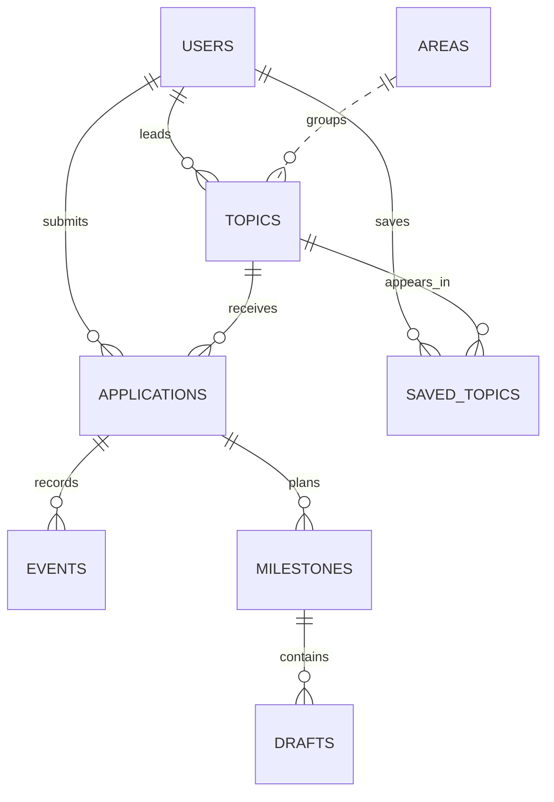

# Студенттердің дипломдық жобаларын тіркеу жүйесі

Студент диплом тақырыбын таңдап, өтінім береді. Ғылыми жетекші оны қарайды, ал кафедра соңғы шешімді қабылдайды. Жетекші келіскенде орын сақталады. Өтінім қабылданбаса, түзетуге қайтарылса немесе студент оны қайтарып алса, орын босайды.

## Іске қосу

Python 3.10 немесе одан кейінгі нұсқа қажет. Windows жүйесінде `start.cmd` файлын іске қосып, браузерден [жергілікті порталды](http://127.0.0.1:8014/) ашыңыз. Бірінші іске қосу кезінде қажетті пакеттер орнатылады, SQLite дерекқоры және сынақ тақырыптары жасалады. Дерекқор келесі іске қосуларда сақталады.

| Рөл | Сынақ аккаунты |
| --- | --- |
| Студент | student@demo.kz |
| Ғылыми жетекші | supervisor@demo.kz |
| Кафедра | department@demo.kz |

### Бар аккаунтты басқа ноутбукке көшіру

Демо аккаунттар әр таза орнатылымда автоматты түрде жасалады. Жергілікті дерекқордағы жеке аккаунтты көшіру үшін PowerShell терезесін жоба қалтасынан ашыңыз.

1. Бастапқы ноутбукте `.\.venv\Scripts\python.exe transfer_account.py export` командасын іске қосып, аккаунттың поштасын енгізіңіз.
2. Жаңа ноутбукте репозиторийді жүктеп, `start.cmd` арқылы бір рет іске қосыңыз. `login.diploma-account` файлын жаңа ноутбукке жеке жолмен жіберіп, жоба қалтасына салыңыз.
3. Жаңа ноутбукте `.\.venv\Scripts\python.exe transfer_account.py import` командасын орындап, бұрынғы пошта және құпиясөзбен кіріңіз.

Тасымалдау файлы рөл мен құпиясөз хэшін қамтиды. Оны GitHub-қа жүктемеңіз, тасымалдап болған соң көшірмелерін өшіріңіз. Өтінімдер мен жобалар аккаунт файлымен бірге көшірілмейді. Render-де тіркелген аккаунтты пайдалану үшін сол Render сайтының мекенжайын жаңа ноутбуктен ашыңыз.

Сынақ аккаунттарының құпиясөзі — `Demo2026!`. Жаңа тіркелгіге студент рөлі беріледі. Әдепкі конфигурация жергілікті көрсетілімге арналған, қайта іске қосылғанда сеанс жаңартылады.

Репозиторийді клондағаннан немесе ZIP мұрағатын ашқаннан кейін `start.cmd` файлын жаңа қалтадан іске қосыңыз. SQLite файлын көшіру қажет емес. Алғашқы іске қосуда демо аккаунттар автоматты түрде жасалады. Бар дерекқорда жүйе тек жетіспейтін демо аккаунттарды қосады және бар құпиясөздерді ауыстырмайды. Демо деректерсіз жаңа дерекқор ашу үшін іске қосар алдында `DIPLOMA_DEMO=0` және жаңа дерекқор жолын көрсетіңіз.

## Техникалық құрылым

- FastAPI маршруттары және серверде қалыптастырылатын Jinja2 беттері.
- SQLAlchemy ORM және SQLite. `users`, `topics`, `applications`, `events`, `saved_topics` кестелері пайдаланушыларды, тақырыптарды, өтінімдерді, шешімдер тарихын және таңдаулы тізімді сақтайды.
- Құпиясөзді Argon2 арқылы хэштеу, JWT сеансы және сервер жағында рөлді тексеру.
- Іздеу, бағыт және бос орын бойынша сүзгі, каталогты беттерге бөлу.
- Тақырып қосу, ашу, өңдеу және жою. Өтінім тарихы бар тақырыптар жойылмайды.
- Кафедра «Бағыттар» бөлімінен каталог бағыттарын қосады, өңдейді және жояды. Бағыт атауы өзгергенде тақырыптар бірге жаңарады. Бағытты жою үшін алдымен оған тіркелген тақырыптарды басқа бағытқа ауыстыру керек.
- Тақырыптар REST API-ы, Pydantic Create/Read схемалары, OAuth2 арқылы JWT алу. [Swagger UI](http://127.0.0.1:8014/docs) және [ReDoc](http://127.0.0.1:8014/redoc) жергілікті серверде ашылады.
- Swagger UI арқылы тексеру үшін жетекші аккаунтымен авторизацияланып, `POST /api/topics` сұрауында `capacity: 0` жіберіңіз. Сервер 422 қайтарады, себебі орын саны кемінде 1 болуы керек.

[Ұқсас жүйелерді талдау және функционалдық талаптар](ANALYSIS.md)

## Тақырып бекітілгеннен кейін

Өтінімде «Жоба жоспарын ашу» батырмасы пайда болады. Жетекші кезеңдерді және мерзімдерді енгізеді. Студент әр кезеңге PDF немесе DOCX файл жүктейді (10 МБ дейін). Жетекші кезеңді қабылдайды немесе түсіндірмемен түзету сұрайды. Алдыңғы файлдар мен шешімдер сақталады. Кафедра жоспар мен нұсқаларды қарай алады. Кезеңдер мен файлдар SQLite дерекқорындағы `milestones` және `drafts` кестелерінде сақталады.

## Қорғауда көрсету

1. Студент ретінде каталогтан бос орны бар тақырып таңдап, негіздемесі бар өтінім жіберіңіз.
2. Жетекші ретінде «Қарау қажет» кезегінен өтінімді ашып, кафедраға жіберіңіз. Кафедра аккаунтымен тақырыпты бекітіңіз.
3. Жетекші аккаунтында бекітілген өтінімді «Барлық өтінім» бөлімінен ашып, жоба жоспарына кезең қосыңыз. Студент аккаунтында жұмыс нұсқасын жүктеңіз. Жетекші түзету сұрағаннан кейін екінші нұсқаны жүктеп, оны қабылдаңыз.
4. Кафедра аккаунтында жаңа бағыт қосып, атауын өзгертіп, бағыты бос кезде жойыңыз.
5. Swagger UI-де `GET /api/topics?page=1` сұрауын орындап, 200 жауабын көрсетіңіз. Жетекші ретінде авторизацияланып, жоғарыда көрсетілген 422 мысалын қайталаңыз.

### Дерекқор байланыстары

`areas.name` және `topics.area` атау арқылы байланысады. Бағытты атау және байланысты тақырыптар бір транзакцияда жаңартылады.
